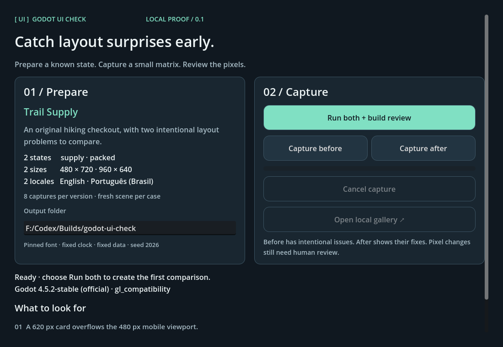
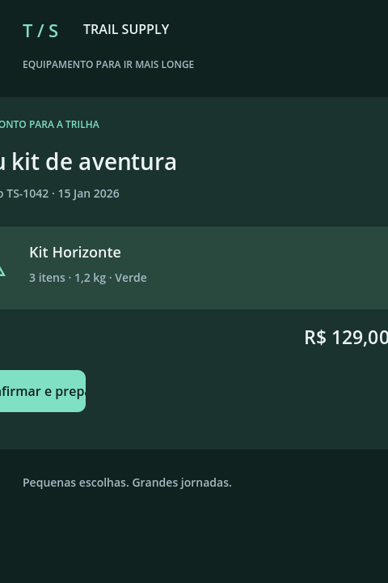
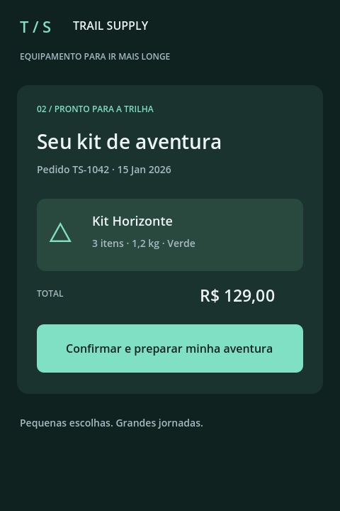

# Godot UI Check

**Prepare a known UI state, capture a small size × language matrix, and review the same case before and after a change.**

A small local visual-review lab by **Douglas Pan / thePan.art**. This is a first usable proof, built and tested with Godot **4.5.2**, **GL Compatibility / OpenGL 3**, on Windows with a Radeon RX 570. It is not a mature regression-testing framework.



## Try the original demo

1. Use an existing Godot 4.5.2 installation. No addon download, account, export template, Android SDK, or package installation is needed.
2. Import `project.godot` in Godot and press **F6** on `lab/lab.tscn`, or launch from the terminal:

   ```powershell
   & 'C:\path\to\Godot_v4.5.2-stable_win64_console.exe' --path . --rendering-method gl_compatibility --rendering-driver opengl3
   ```

3. Choose an absolute writable output folder, then click **Run both + build review**.
4. Click **Open local gallery**, or open the generated `review-*/index.html` manually in your browser. The gallery is a standalone file with embedded PNGs; it needs no local web server.
5. Select a case and use **Wipe**, **Overlay**, **Before**, or **After**. The range control works with arrow keys. Pixel changes are diagnostic; a human decides whether the layout is correct.

The native demo captures two states (`supply`, `packed`), two resolutions (480×720 and 960×640), and two locales (`en`, `pt_BR`): **8 captures per version, 16 for a comparison**. Every run creates a new folder. Existing captures are never promoted or overwritten automatically.

| Before: intentional overflow and clipped action | After: viewport-relative card and readable action |
|---|---|
|  |  |

Trail Supply is an original fictional hiking checkout built entirely from Godot controls. The before version has a 620 px card that overflows a 480 px viewport and a fixed-width action that clips Portuguese text. The after version fits the viewport and allows action text to wrap. No artwork or code from private game projects is included.

## Prepare your own states

Copy `addons/ui_check/` into your Godot project. Create a small harness that registers scenes with setup callbacks:

```gdscript
const CaptureRunner = preload("res://addons/ui_check/capture_runner.gd")
const Review = preload("res://addons/ui_check/report.gd")

func capture_cart() -> void:
    var runner = CaptureRunner.new()
    add_child(runner)
    runner.register_state("cart-ready", preload("res://cart.tscn"),
        func(scene, ctx):
            scene.set_items(ctx.data.items)
            scene.show_checkout()
    )
    var sizes: Array[Vector2i] = [Vector2i(480, 720), Vector2i(960, 640)]
    var locales: Array[String] = ["en", "pt_BR"]
    var result = await runner.run("user://ui-check", "before", sizes, locales,
        {"data": {"items": [{"name": "Demo item", "quantity": 2}]}})
    print(result.status, " ", result.get("folder", result.get("error", "")))
```

The callback receives a fresh instance inside the correctly sized SubViewport. Context includes `phase`, `size`, `locale`, `seed` (2026), a fixed `clock` string, and a deep copy of supplied `data`. Prefer short, synchronous callbacks that set state directly. Avoid navigation scripts, external I/O, long-running awaits, wall-clock values and global RNG; callback exceptions cannot be caught by this proof. The callback may return `false` to report a preparation failure.

Capture `before` on the old code, change the layout, then capture `after` on the new code. In the demo only, the callback switches the intentional bug by phase so both versions can be explored immediately. Your own project should prepare the same data in both runs.

To compare existing completed runs across separate invocations:

```powershell
godot --headless --path . --script res://tools/compare.gd -- 'C:/captures/before-run/manifest.json' 'C:/captures/after-run/manifest.json' 'C:/captures'
```

The reusable `Review.write_pair(before_manifest, after_manifest, output_folder)` API does the same. Keep manifests and PNGs together; the current comparator uses the absolute capture-folder paths recorded in each manifest. Moving capture folders requires updating those paths. The generated HTML itself is portable.

## What it does

- Registers named scenes with simple callbacks; uses one fresh instance per matrix cell.
- Captures sequentially with a real Godot renderer, using isolated SubViewports without resizing the main window.
- Sets locale, freezes scene processing after preparation, settles layout, and waits for a rendered frame with a five-second deadline.
- Restores locale, time scale and FPS after success, cancellation or handled failure. It preserves the existing pause state and window size by leaving them untouched.
- Saves PNGs, raw-pixel SHA-256 digests and a JSON manifest as the run progresses. Cancellation keeps an explicitly incomplete manifest and partial evidence.
- Generates a portable before/after gallery and JSON pixel-difference report. It rejects mismatched capture matrices and engine/rendering environments.

## Determinism and limits

The demo pins Godot's bundled fallback font through its theme and uses fixed copy, date, order ID and quantities. It has no animations, network calls or wall-clock logic. Repeated runs on the tested engine/driver produced identical pixel hashes for all 8 before and all 8 after cases. See [test evidence](docs/TEST_RESULTS.md).

Processing is disabled after state setup; rendering is still active. This does not make arbitrary game scenes deterministic: shader `TIME`, particles, font fallback, asynchronous resources and viewport-dependent code need explicit preparation. User callbacks must keep their scene and viewport alive. Capturing `CanvasLayer` content that explicitly targets another viewport, native dialogs or screen-space effects is not validated. RTL/CJK, other engines, renderers, drivers and operating systems are untested. Headless mode uses a dummy renderer and is explicitly rejected for screenshots.

Visual review of the generated gallery in an automated browser is **pending**: the execution environment blocked `file://` navigation. Its JavaScript was syntax-checked and its generated data/images were checked; manual opening is still required. No cross-machine pixel stability or layout correctness is inferred from a small diff percentage.

## Tests

Run against an installed Godot. Visual tests require a working graphical session and briefly create a Godot window.

```powershell
.\tools\run.ps1 -Godot 'C:\path\to\godot.exe' -Mode render-tests -Output 'C:\captures\ui-check-tests'
.\tools\run.ps1 -Godot 'C:\path\to\godot.exe' -Mode logic-tests -Output 'C:\captures\ui-check-tests'
```

Or use the engine directly:

```text
godot --path . --rendering-method gl_compatibility --rendering-driver opengl3 --script res://tests/run_tests.gd -- --output C:/captures/ui-check-tests
godot --headless --path . --script res://tests/run_tests.gd -- --logic-only --output C:/captures/ui-check-tests
```

The suite checks registration, invalid input, real captures, repeat hashes, restoration, early and partial cancellation, recovery, setup and I/O failures, reports, environment mismatch, and the native primary action. Each invocation writes its own test-results JSON and screenshots. A nonzero exit means failure. `tools/check_review.js` performs dependency-free syntax and generated-report checks with an existing Node.js installation; Node is optional and not needed to use the lab.

File logging is disabled by default to avoid unwanted application-data writes. The PowerShell launcher redirects logs into the chosen output folder. A restricted host may also block Godot's shader cache or certificate-store reads; those messages occurred on this host without invalidating the image/test results. No network is used by the project.

## Existing work and scope

Screenshot capture and visual comparison are established workflows. [gdUnit4 issue #655](https://github.com/godot-gdunit-labs/gdUnit4/issues/655) describes the practical pain of reaching a UI state and inspecting clipping across sizes. [godot-screenshots](https://github.com/treepumpkin/godot-screenshots) already captures bursts across resolutions/locales, [godot-qa](https://github.com/youichi-uda/godot-qa) runs scripted playtests and screenshot checks, and [godot-ui-automation](https://github.com/graydwarf/godot-ui-automation) provides record/replay and screenshot validation. Read the [workflow comparison](docs/RESEARCH.md).

This proof explores a narrower emphasis: **direct state preparation and convenient local review**. No novelty, adoption or superiority claim is made. No code or assets from those projects were copied or vendored; possible interoperability is a future discussion.

## Contribute

Start with [CONTRIBUTING.md](CONTRIBUTING.md) and the [roadmap](docs/ROADMAP.md). Small reproducible scenes, accessibility feedback, localization cases and engine/renderer reports are especially useful. Keep the project local and dependency-light. There is no backend, account, required AI, replay engine or Android build.

## License and credit

Original code, original demo and generated demo screenshots: **MIT**, copyright © 2026 **Douglas Pan / thePan.art**. Godot is a separate MIT-licensed runtime with its own third-party notices; it is not redistributed here. See [LICENSE](LICENSE) and [THIRD_PARTY_NOTICES.md](THIRD_PARTY_NOTICES.md). The provisional project name does not imply affiliation with the Godot Foundation.
